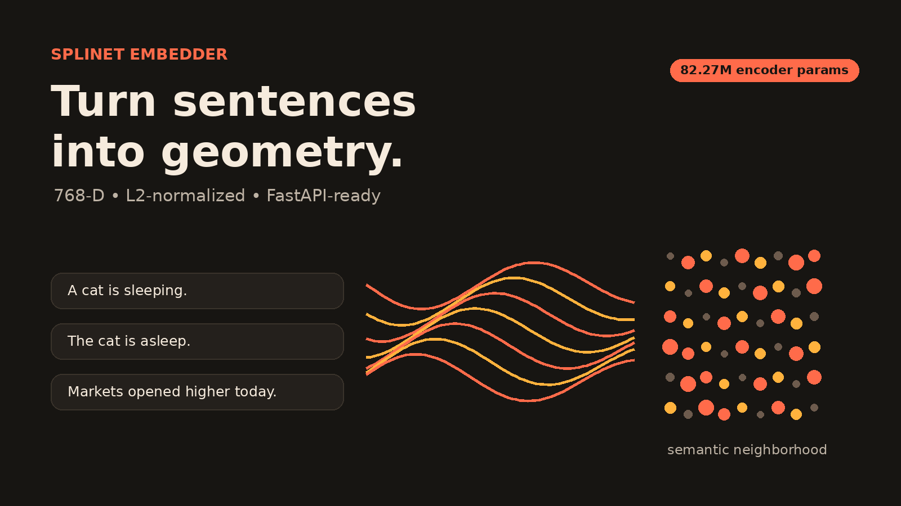
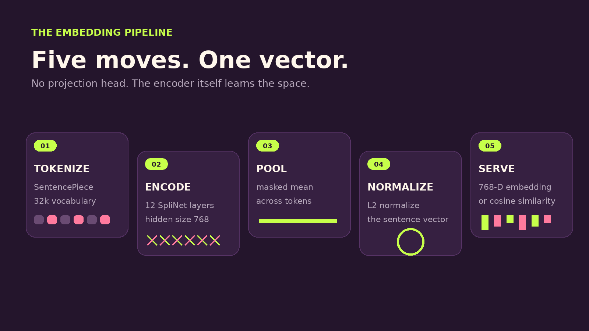
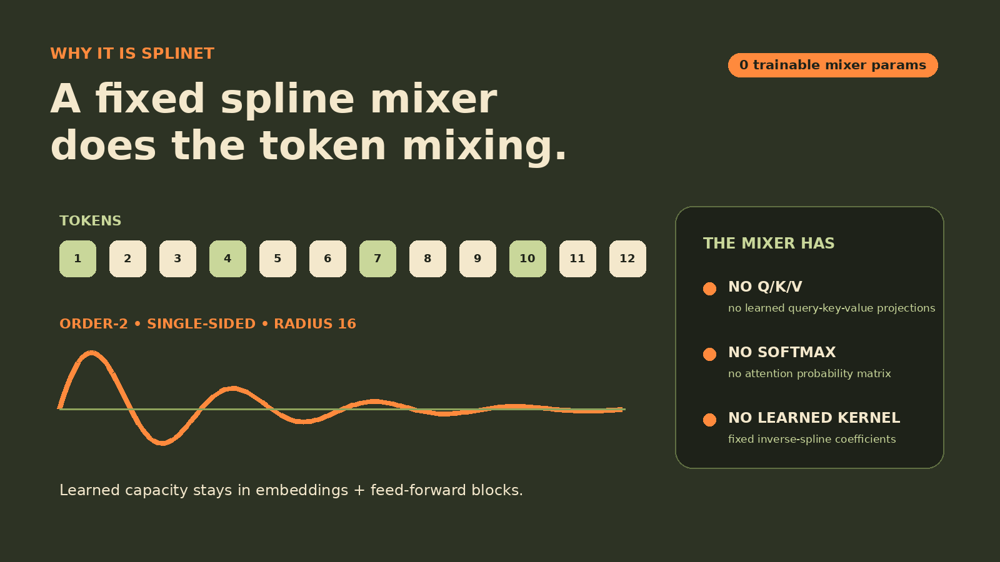
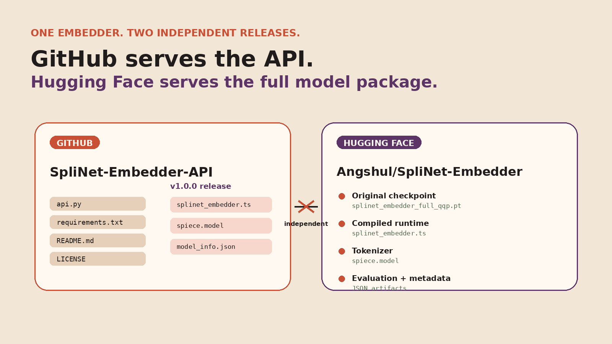

# SpliNet Embedder  
## Stop pretending every embedding problem needs another BERT clone.

If the only thing we know how to do in representation learning is to throw attention at everything, then the field deserves to be mocked a little.

**SpliNet Embedder** is the opposite of that reflex. It takes the released **SpliNet** encoder and pushes it into a clean sentence-embedding pipeline: compact, explicit, deployable, and not pretending to be a bloated research cosplay project.

It is not a toy notebook. It is not a fake “demo” with hand-picked examples. And it is definitely not another repo dumping weights, notebooks, and random junk into one place and calling it an API.

Instead, this project draws a hard line between **the model release** and **the serving layer**.

- **GitHub API repo:**  
  https://github.com/AngshulMajumdar/SpliNet-Embedder-API
- **Hugging Face model release:**  
  https://huggingface.co/Angshul/SpliNet-Embedder

---



## What this actually is

SpliNet Embedder is a sentence-embedding version of **SpliNet**, a masked-language-model encoder that replaces the usual “attention everywhere” dogma with a **fixed spline-based token mixer**.

For the embedder, the encoder is fine-tuned to produce sentence vectors through a very clean recipe:

1. tokenize the sentence,
2. encode it with SpliNet,
3. apply **masked mean pooling**,
4. **L2-normalize** the result,
5. expose the vector through a lightweight API.

The result is a practical sentence encoder with:

- **82,270,464 encoder parameters**
- **768-dimensional embeddings**
- **maximum sequence length = 512**
- **masked mean pooling**
- **L2-normalized output vectors**

That is the entire point: no fluff, no ornamental abstraction, no “agentic” nonsense around what should be a straightforward embedding service.

---

## The pipeline is brutally simple

Most embedding writeups try to look impressive by becoming unreadable. This one doesn’t need that crutch.



The full flow is:

- **Tokenize** with the shared SentencePiece tokenizer.
- **Encode** through the SpliNet stack.
- **Pool** across valid tokens with masked mean pooling.
- **Normalize** to produce a stable semantic vector.
- **Serve** through FastAPI for embeddings or similarity.

That simplicity matters. It makes the system easy to inspect, easy to deploy, and hard to fake.

---

## Why SpliNet is not just “another encoder”

Here is where the project becomes genuinely interesting.

The original **SpliNet** architecture replaces conventional attention/Fourier token mixing with a fixed, **zero-parameter, order-2, single-sided cardinal B-spline mixer**. In plain language: the sequence mixing step is structured, explicit, and does not waste trainable capacity on attention-style machinery.



That means the mixer has:

- **no learned query/key/value projections**
- **no softmax attention matrix**
- **no learned mixer coefficients**

The learned capacity stays where it should stay: the embeddings, the feed-forward blocks, and the rest of the encoder scaffold.

That is not only cleaner conceptually. It is also a direct rebuke to the lazy assumption that every sequence model must blindly reproduce the Transformer template to be taken seriously.

---

## Fine-tuned like a real system, not a fake benchmark prop

The sentence embedder is fine-tuned on **134,378 positive QQP duplicate pairs**, for:

- **1 epoch**
- **8,958 optimization steps**

Again: this is not pretending to be a giant foundation model. It is a purpose-built sentence encoder. That honesty is a strength, not a weakness.

A lot of projects hide behind inflated claims. This one does the useful thing instead: it declares what it is, exposes the deployment artifacts, and publishes the evaluation footprint.

---

## Two releases. Two jobs. Zero confusion.

One of the more annoying habits in open-source ML is shoving everything into one repository and calling the resulting mess “reproducible.”

This project refuses to do that.



### 1) GitHub repo = serving layer

The GitHub repository contains the lightweight API surface:

- `api.py`
- `requirements.txt`
- `README.md`
- `LICENSE`

That repo is for **deployment logic**, not for hoarding bulky model artifacts.

### 2) Hugging Face = model release

The Hugging Face model card contains the model package itself:

- compiled runtime
- original checkpoint
- tokenizer
- metadata
- evaluation artifacts

That separation is not cosmetic. It is architectural hygiene.

The GitHub project and the Hugging Face project are related, but they are not a single undifferentiated blob. Good. They shouldn’t be.

---

## The API is lean on purpose

The API exposes exactly the functionality people actually need:

- **`/health`**
- **`/model-info`**
- **`/embed`**
- **`/similarity`**

That is enough.

Not every repo needs to mutate into a startup pitch deck. Not every model release needs an orchestration circus around it. A sentence embedder should embed sentences and compute semantic similarity. Anything beyond that is optional decoration.

### Install

```bash
pip install -r requirements.txt
```

### Run

```bash
python api.py
```

or

```bash
uvicorn api:app --host 0.0.0.0 --port 8000
```

### Quick Python use

```python
from api import encode, similarity

embeddings = encode([
    "A cat sits on a mat.",
    "There is a cat on the mat."
])

print(embeddings.shape)
print(
    similarity(
        "A cat sits on a mat.",
        "There is a cat on the mat."
    )
)
```

### Quick REST use

```bash
curl -X POST http://localhost:8000/embed \
  -H "Content-Type: application/json" \
  -d '{"texts":["A cat sits on a mat.","A dog runs outside."]}'
```

```bash
curl -X POST http://localhost:8000/similarity \
  -H "Content-Type: application/json" \
  -d '{"text_a":"A cat sits on a mat.","text_b":"There is a cat on the mat."}'
```

---

## Evaluation: full datasets, not excuses

This is where a lot of “demo” repos fall apart.

They love vibes. They hate measurement.

SpliNet Embedder does the opposite. It reports actual evaluation across three different behaviors:


### STSBenchmark
- **Pearson:** 0.5257  
- **Spearman:** 0.5174  
- **Full test set:** 1,379 pairs

### SciFact retrieval
- **nDCG@10:** 0.1928  
- **MAP@10:** 0.1686  
- **MRR@10:** 0.1766  
- **Recall@10:** 0.2614  
- **Recall@100:** 0.4413  
- **Scale:** 5,183 documents, 300 queries

### Twenty Newsgroups clustering
- **Mean V-measure:** 0.1532  
- **Mean homogeneity:** 0.1510  
- **Mean completeness:** 0.1555  
- **Scale:** 59,545 texts

No, these numbers are not being sold as magic. They are being shown as they are: a real evaluation footprint for a real sentence encoder.

That already puts this project above the usual “trust me bro, it works” standard that infects far too many model repos.

---

## Deployment notes that actually matter

The implementation does a few practical things correctly:

- selects **CUDA automatically** when available,
- uses **FP16 autocast** on CUDA inference,
- falls back by **halving the batch size** if a batch exceeds available GPU memory,
- keeps the serving layer lightweight.

That is what professional small-model deployment should look like: not inflated, not theatrical, just correct.

---

## Why this project matters

Because the field keeps repeating the same mistakes:

- overbuilt APIs,
- underbuilt documentation,
- chaotic repos,
- vague model provenance,
- and a pathological need to treat every project like a mini operating system.

SpliNet Embedder goes in the opposite direction:

- clean encoder story,
- explicit model packaging,
- clean API surface,
- independently maintained GitHub and Hugging Face distributions,
- full evaluation footprint,
- practical deployment behavior.

That combination is rarer than it should be.

---

## Final take

If you want yet another project that worships architectural bloat, hides behind fashionable abstractions, and treats reproducibility as optional theater, look elsewhere.

If you want a compact sentence embedding system built from an actually interesting encoder, released with deployment discipline instead of repository chaos, **SpliNet Embedder** is the better answer.

It does not try to impress by being noisy.

It is stronger than that.

---

## Links

- **GitHub API repo:**  
  https://github.com/AngshulMajumdar/SpliNet-Embedder-API

- **Hugging Face model release:**  
  https://huggingface.co/Angshul/SpliNet-Embedder

- **Base SpliNet repository:**  
  https://github.com/AngshulMajumdar/SpliNet
